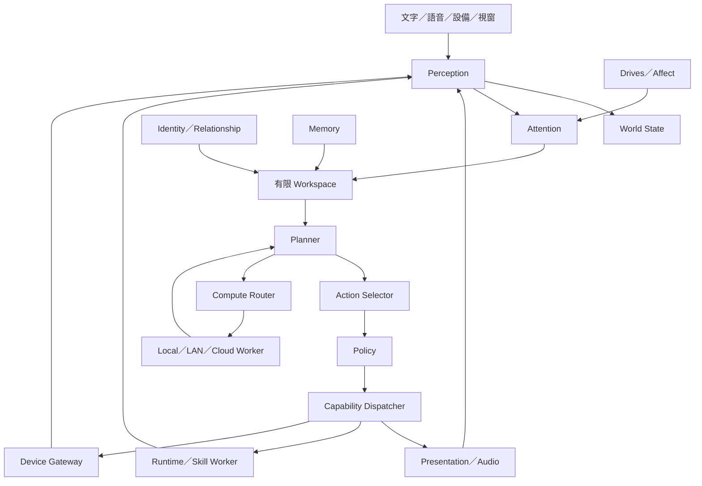

# SIRO 2 詳細作業流程計劃書

版本：1.0｜2026-09-23｜狀態：待實作的工程基線

本計劃依據使用者分享的 SIRO 對話，從舊 Bridge 通道衝突、重新設計、數位陪伴角色，一路涵蓋人腦／果蠅控制啟發、智慧環境、資源調度與分散式算力。來源與需求逐項對照見 [SOURCES.md](SOURCES.md)。本文新增的技術選擇、數值與工序是工程提案，不代表原對話已確認，亦不代表程式已完成。

## 1. 最終成果與專案邊界

SIRO 是長期存在的數位陪伴角色。她的名字、共同經歷、偏好、關係與技能留在可備份的狀態資料中，模型與 Live2D 都可以替換。

完整產品基線必須做到：

1. 文字和語音對話、繁體中文、串流輸出、可打斷。
2. 一個實際可用的 Live2D 身體，語音口型、表情、斷線恢復與低資源降級。
3. 跨重啟保留 Identity、五類記憶、關係、任務及自己的歷史。
4. 感知環境、有限注意力、情境驅動的主動行為；可安靜、可暫停。
5. 完整電腦控制能力分類：觀察、檔案、程序、shell、瀏覽器、UI、系統服務；由 Runtime 根據授權執行。
6. Skill/plugin 可安裝、停用、隔離、升級、回退；新增設備無須修改 Core。
7. MQTT、ESP32、Home Assistant 的可驗證設備閉環。
8. 記憶整理、技能候選生成、程式修改提案及可回滾更新。
9. Compute Governor 與任務級跨節點運算；資源不足、模型失敗、斷網時仍維持基本身份與狀態。
10. 從乾淨環境安裝、備份還原、可追溯決策、長時間運行。

產品完成分兩個標籤：**v1.0 本機完整陪伴版**完成 T00–T35；**v1.1 算力擴充版**再完成 T36–T40。使用者要求的完整基線指 v1.1，不可把 v1.0 說成已含多機。模型切層、神經元模擬、訓練自有大模型列為 R 系列研究，以報告結案，不擋住產品；若使用者日後要求將某研究納入正式產品，另增範圍和驗收。

「數位女兒」是角色與互動方向，工程驗收採記憶一致性、行為、可控性與可靠性；不以真正意識或通用人工智慧作為可交付承諾。

## 2. 現況、假設與待確認事項

已知：本機 `SiroV2` 起始 commit 為 `c060f1b`，原先只有 `.gitattributes`。分享對話中的舊版完成紀錄只能視為歷史敘述，不繼承為新專案驗收成果。尚未稽核舊碼，Bridge 衝突的具體根因也尚未重現。

暫定：單一擁有者、單一 Identity、本地資料庫、Linux 為第一個實測平台；Windows 使用相同契約，另外交付 adapter 與實測，不假設 Linux 測試等同 Windows 支援。

| 未知 | 開發預設 | 必須補齊的時點 |
|---|---|---|
| 目標 CPU/RAM/GPU 與作業系統 | T00 盤點；mock 不需 GPU | 選本地模型、效能驗收之前 |
| 雲端 provider、費用上限、資料可外送範圍 | 預設 mock，雲端路由關閉 | T07 真實 provider、T38 雲端路由之前 |
| Live2D 模型與聲音授權 | 先用合法測試資產／空白 renderer | T12、T15 真实體驗驗收之前 |
| 是否已有 ESP32／Home Assistant／第二台主機 | 模擬 adapter | T27–T29、T39 真機驗收之前 |
| 人格初始值與稱呼 | 名字 SIRO；其他設定可編輯、非自動猜測 | T08 使用者體驗驗收 |
| 安靜時間與主動頻率 | 主動功能預設關閉，啟用後沿用本計劃初值 | T20 使用者啟用時 |

這些缺口不阻止先實作契約與模擬器；缺真實測試者標記 blocked-external，不能以 mock 冒充完整通過。

## 3. 架構與責任



單一 Core 程序容納邏輯模組，不把每個「腦區」變成微服務。跨故障風險才拆程序：

| 程序 | 擁有的狀態與責任 | 禁止承擔 |
|---|---|---|
| siro-core | identity、world、memory、conversation、policy、action state | 直接執行 shell、播放聲音、控制 Cubism |
| siro-presentation-gateway | 連線 session、writer queue、snapshot 轉譯 | 人格、記憶抽取、工具許可 |
| renderer | 畫面、動作、眨眼、口型、可見狀態 | 私自觸發 LLM 或設備 |
| siro-audio | VAD/STT/TTS、音訊串流與播放協調 | 決定人格／工具風險 |
| siro-runtime | OS 能力、權限落實、程序生命週期、審計 | 生成對話、改人格 |
| skill-worker | 一次任務的受限執行環境 | 共用 Core DB、取得額外權限 |
| device-gateway | MQTT/HA/ESP32 轉譯、設備認證 | 對原始 sensor 數據呼叫 LLM |
| compute-worker | 模型／索引等計算任務、資源回報 | 作為第二個 Identity 寫入者 |

P0–P1 先跑 Core 和 mock。P2 建立跨程序通訊；後續每個 service 都獨立健康檢查、超時與重新啟動。LLM worker 和第三方 SDK 阻塞不影響 control loop。單個 Core 暫時故障時 renderer 仍能顯示斷線；不宣稱 Core 故障後還能完整認知。

## 4. 預設技術路線

為減少 Sol 每階段重新選型，採以下基線；T00 驗證可用版本後鎖定，無證據不換技術。

| 項目 | 基線決策 | 更換條件 |
|---|---|---|
| Core、adapter、測試 | Python 3.12+、asyncio、Pydantic、pytest、ruff、mypy、uv | 依賴不相容或實測瓶頸，先 ADR |
| 本地持久化 | SQLite WAL；Core 為主要資料唯一 writer；FTS5 起步 | 量測證明需多寫入者／資料規模超限 |
| 程序間事件 | NATS Core 作即時通知；JetStream 作需 ack 的 durable 消息 | 測試必須驗證離線、重送、背壓 |
| 持久化一致性 | SQLite transaction + outbox/inbox 去重 | 不假定 broker 提供跨系統 exactly-once |
| UI gateway | HTTP + 分離 WebSocket；loopback 預設 | remote 時啟用經認證與加密的入口 |
| 身體 | AIRI adapter 優先做短期可行性驗證 | 無法外接時改最小 Web Live2D renderer，仍需真 Live2D 驗收 |
| OS runtime | Rust 獨立 executable；本機受限 RPC、後續 gRPC 遠端 | T21 鎖定單一 protocol 並生成 SDK |
| 初始 UI 工具 | TypeScript、Vite、Vitest、Playwright | 配合已驗證 AIRI integration，不另造完整桌面框架 |
| 設備 | MQTT + Home Assistant adapter；模擬 ESP32 起步 | 同能力不同傳輸只改 adapter |
| 模型 | mock + 至少兩個可互換 LLM adapter | Core 不依赖模型品牌 |
| 部署 | 單機腳本／user service；測試 broker 可用容器 | 目前不用 Kubernetes、客製 Linux OS、OTA 分區系統 |

這些是 SIRO 的工程選擇。SQLite WAL 的多讀單寫與同主機限制、NATS 消費者的 ack／redelivery 行為應依 [官方來源](SOURCES.md) 落實，不能僅憑名稱推測可靠性。

### 4.1 套件與目錄目標

```text
AGENTS.md
README.md
pyproject.toml / uv.lock                 # T01 建立
src/siro/{core,contracts,ports,adapters,persistence,cli}
services/{presentation,audio,devices,compute}
runtime/                               # Cargo workspace
ui/                                    # 可檢查的開發 UI／身體 adapter
schemas/{events,skills,devices,compute}
config/{defaults,profiles,examples}
tests/{unit,contract,integration,e2e,fault,fixtures}
scripts/                               # 開發、驗收、備份、升級入口
docs/{PLAN,CONTRACTS,TASKS,ACCEPTANCE,SOL_RUNBOOK,STATUS,DECISIONS,SOURCES}.md
docs/evidence/<task-id>/                # 合成資料測試證據
```

真實執行資料在使用者資料目錄；不把 SQLite、錄音、憑證、下載模型或第三方 repo 放進來源版控。

## 5. 開發順序與里程碑

| 階段 | 任務 | 可展示成果 | 放行條件 |
|---|---|---|---|
| P0 基線與契約 | T00–T04 | 一致規格、可用開發命令、事件與資料遷移 | 契約測試、乾淨安裝 |
| P1 文字認知核心 | T05–T08 | 可對話、取消、記住身份、查詢來源 | 文字閉環及重啟測試 |
| P2 通道與身體 | T09–T12 | 獨立 UI／Live2D，不被慢工具卡住 | 先通過舊 Bridge 類故障回歸 |
| P3 音訊與打斷 | T13–T16 | 可聽、說、嘴型、打斷、文字降級 | 單一 playback owner、真麥克風測試 |
| P4 記憶與主動性 | T17–T20 | 可回憶、更正、Dream、合理主動 | 合成長期測試＋人工對話驗收 |
| P5 技能與電腦 | T21–T25 | plugin、檔案、shell、browser、UI、服務 | 權限與故障隔離、實際動作回讀 |
| P6 智慧環境 | T26–T29 | 設備圖、ESP32 觀測、HA 動作閉環 | 真機、斷線、重送、過期資料測試 |
| P7 迭代與運行 | T30–T35 | 可產生技能、更新回退、資源降級、安裝還原 | 24 小時測試與 v1.0 checklist |
| P8 分散式算力 | T36–T40 | 第二台主機承擔模型任務、故障轉移 | 真實双節點及 v1.1 整合驗收 |
| R 研究 | R01–R03 | 分層推論評測與認知研究結論 | 可重現數據／採納或不採納決策 |

每張任務卡是一個可審閱工作單元，不是保證一次模型回覆能完成。預算估算採完成首五張卡後的中位工時重新估算；不以模型速度承諾固定完工日。若某卡牽涉超過一個新的外部整合或同時改三套契約，拆成子卡。

## 6. 認知閉環的具體行為

### 6.1 Perception、World、Attention

Perception 驗證並正規化輸入，附 provenance、timestamp、confidence。World State 用最新有效觀測與版本做投影；人不在房間與 sensor 離線不同，未知就是 unknown。歷史觀測进入 Memory，不把歷史事實當成即時狀態。

視覺分 capture 與 analysis：T24 提供螢幕觀察與 VisionModel adapter，T26 讓相機作另一種 capture device；原圖預設短期保存、分析後清理，受 privacy 與啟用設定限制。先以按需擷取／變化觸發，Governor 可降頻。模型文字描述仍是帶信心的推測，不能直接當 UI 座標或設備授權。

Attention 先採可測試規則。初始分數為 `0.35*urgency + 0.25*user_relevance + 0.15*novelty + 0.15*goal_relevance + 0.10*drive_relevance`；各輸入 0–1，門檻初值 0.6。明確使用者輸入不因分數低被忽略，stop／cancel 是獨立高優先級控制。權限是硬性 gate，不進加權分數。

Workspace 初值只保留 1 個前景對話、3 個候選目標、20 個相關事件。上下文上限取 provider 容量與設定預算較小值，先保留 Identity 摘要、當前請求、有效工具結果，後截減低相關記憶；保留輸出預算。容量數字需在 T19 量測後校準。

### 6.2 Planner、Action Selector 與 Goal

Planner 輸出結構化候選動作，包含 capability、argument、預期結果、成本與截止時間；不直接執行。Action Selector 先套 permission、quiet hours、busy、cooldown、資源 gate，再評分。`do_nothing` 是有效候選。

Goal 狀態：proposed → ready → running → waiting_external／completed／failed／cancelled。每個 goal 有下一動作、上限步數、deadline、取消 token；初值工具呼叫最多 8 次、整體 120 秒，超出就報告進度，不無限自己接自己。延長需新設定或使用者需求。

### 6.3 Identity、關係、Affect

Immutable core 由擁有者編輯、版本化；程式或模型不自動改。Traits、preferences、habits、relationship 是衍生狀態，有證據、版本、撤銷。暫定每次 consolidation trait 最大變動 0.01、每週累積最大 0.05，至少三個獨立事件支持；這是可調工程限制，不是心理學定律。

Affect 可影響表情、語氣與主動候選排序，永不增加權限。換 LLM 後 identity_id、關係、記憶來源仍相同；不以逐字回答一致作驗收。

### 6.4 五類記憶與 Dream

Working 保存當前內容，Episodic 保存事件，Semantic 保存可更新事實，Procedural 保存流程／技能版本，Self 保存自身經歷；relationship 以獨立投影連到記憶證據。

寫入順序：可追溯原事件 → episode → candidate fact／reflection → 驗證 → 新版本。LLM 推論與使用者明確陳述分別標示，衝突不能靜默覆寫。使用者可檢查、更正、刪除；衍生索引和摘要也應撤銷，備份保留期限另明示。

Dream 初值只在 idle 且資源足夠時執行，每批最多 100 個來源、最多 60 秒計算預算；可取消、有 checkpoint、重啟不重複產生 facts。Dream 不直接觸發設備、不自動授權新技能、不把幻想寫為真實經歷。

### 6.5 主動性

觸發來源：有效環境變化、到期未完任務、可回憶事件、drive 候選。定時器只負責喚醒評估，不保證說話。初值：啟用後 quiet hours 23:00–08:00（Asia/Taipei），主動社交最短間隔 30 分鐘，每日最多 6 次；明確使用者請求與其指定提醒另計。會議、busy、正在說話、勿擾時抑制非必要發言。

## 7. 通道、取消與故障隔離

每個 connection 由單一 sender task 寫出。control、mic uplink、playback downlink 分開；MQTT 不共用語音 WS。大型媒體不進 durable event bus，只放有期限的 media reference。

取消路徑必須獨立：user speech start／stop → Core 標記 turn cancelled → 發出高優先取消 → audio 停止並清 buffer → LLM/TTS 取消 → UI 標記完成中止。Core 及所有輸出端都丟棄舊 turn 的遲到 chunk；不能只靠 provider 成功取消。

佇列上限、delivery class、ack 和超時見 [CONTRACTS.md](CONTRACTS.md)。UI 斷線只移除該連線 sender，不刪 Identity。runtime 卡住不阻斷文字與 body heartbeat；broker 暫時失效時 Core 顯示 degraded、停止新跨程序動作，持久化 outbox，不假裝設備已操作。

故障恢復重試初值 1、2、4、8 秒，帶 jitter，最多 5 次；持續失敗打開 circuit breaker 30 秒。只對安全冪等查詢或確定未發生的任務重試。處於 running 的危險動作重啟後先 reconcile，再決定結果。

## 8. 電腦、外掛與設備

完整電腦控制指能力覆蓋完整，並非讓語言模型常駐 root。Runtime 分 Observe、Normal Action、Destructive、System、Critical 五級；同一讀檔能力也可能讀到敏感路徑，不能只靠名稱定風險。

Permission grant 包含 actor、skill、scope、動作雜湊、期限、次數與撤銷狀態。可預先授權日常範圍，避免每次點擊都詢問；system／critical 保留有範圍的顯式授權或人工步驟。所有工具完成後驗證狀態，而不是收到命令就算成功。

Skill lifecycle：discovered → validated → installed-disabled → enabled → quarantined／disabled → removed。manifest 包含 schema、權限、resource budget、timeout、rollback／compensation、版本相容性；第三方 code 在 worker 執行，停用時阻止新 dispatch 並處理在途任務。

Device registry 描述 properties、actions、events、位置與相鄰關係；初版用 SQLite 關聯表，不需要 graph DB。MQTT availability、retained state、command ack 和實際讀回分開處理。採 `light.set(on=true)` 等冪等期望狀態，避免重播 toggle 導致反轉。

## 9. 自我迭代

人格成長是有證據的小幅狀態更新。技能成長是從成功流程產生候選 → 合成資料測試 → scope 檢查 → 版本登錄。程式成長是 patch proposal → 獨立 branch/workspace → checks → 審閱或既有可信發布政策 → staged install → healthcheck → activate／rollback。

不在運行中的 production source 原地改自己；不讓候選技能自行提升授權。最後可用版本包含程式、設定、schema 相容性及資料備份點。資料庫若不能 backward-compatible，必須停寫備份、演練還原，單獨回退 executable 不算成功回滾。

## 10. 資源與分散式算力

### 10.1 四層資源安排

L0 是取消、VAD、body idle 等低延遲反射；L1 是事件、world、policy、索引查詢；L2 是語言／視覺推論；L3 是 Dream、embedding 批次、程式生成。L3 可暫停，不能搶走 L0 資源。

起始部署 profile：

| 模式 | 常駐 | 隨需 | 退化後仍可用 |
|---|---|---|---|
| minimal | Core、基本 UI、Runtime | mock／已允許遠端 LLM | 文字狀態、Identity、規則命令 |
| companion | 上述＋音訊／Live2D | STT/TTS/embedding、LLM | 文字與静音身體 |
| local-ai | companion | 一個重型模型槽，其他排隊 | 小模型／規則或明示 unavailable |
| distributed | companion＋node registry | 指定 LAN worker | 本機可用能力；遠端任務明確失敗 |

Governor 每秒採樣，滾動 10 秒；起始高水位 RAM 85%、VRAM 90%，低水位 70%／75% 且維持 30 秒才恢復，避免反覆卸載。無 GPU 時略過 VRAM 檢查。優先暫停 L3、降低視覺頻率、卸載閒置模型，再選已授權路由；不能因 RAM 滿就把私人資料自動送雲端。provider 成本有每次上限、每日配額，預算未設定時關閉付費自動路由。

所有 RAM、CPU、延遲值是初始配置與驗收目標；T00 建立目標主機表，T33 實測後修訂，不能保證任何「普通電腦」都足夠。

### 10.2 Compute Fabric

首先拆整個工作：本機 Core／語音、第二台 LLM、另一節點 embedding。Scheduler 先按 capability、privacy、版本、可用記憶體、deadline 篩选，再比較 queue time + load time + compute time + transfer time，選估計成本最低且合規的節點。

Core 保持唯一 durable state writer。worker 收到有限上下文與 job_id，不拿整份私人資料庫。心跳過期節點退出新路由；在途任務用 lease epoch 防止舊結果覆寫新 attempt。read-only inference 可重試；真實設備與 OS 副作用仍留給所屬 runtime 的 action ledger。

### 10.3 模型切層與研究界線

GPipe 是 pipeline 訓練研究，不能直接證明家庭 LAN 逐 token 推論更快。Switch Transformer 是模型內稀疏專家機制；SIRO 把不同任務送到不同完整模型稱為「任務路由」，不宣稱自己實作了模型內 MoE。Mensa 借鑑異質硬體及通訊成本；不把論文倍率直接寫成 SIRO 效能。詳見 [研究來源](SOURCES.md)。

R01 同時比較單節點小模型、強節點遠端整模、跨節點切層；控制模型、量化、輸入長度、輸出長度與量測模式，分開報告 batch=1 latency 與 throughput。記錄 TTFT、token/s、峰值 RAM/VRAM、流量、功耗可得性、品質及節點故障成本。只有解除容量限制且互動 SLO 可接受，或在同品質下 p95 延遲改善至少 20%，才提出產品整合；門檻是本計劃採納準則，不是論文結論。

## 11. 體驗、安全、驗收與發布

使用者第一次設定、日常對話、權限、記憶、設備、通知和無障礙入口遵循 [EXPERIENCE.md](EXPERIENCE.md)。信任區、prompt injection、資料分類、保存/刪除、密鑰、供應鏈及本機 kill switches 遵循 [SECURITY_PRIVACY.md](SECURITY_PRIVACY.md)。這兩份規格與功能契約同為任務驗收輸入；不能只通過 API 測試便宣稱產品可用或安全。

每一階段先做 mock 合約測試，再用真實 provider／身體／硬體驗收。完整 scenario 與效能定義見 [ACCEPTANCE.md](ACCEPTANCE.md)。最低不可退讓項目：事件可追蹤、舊 turn 不回放、工具不重複副作用、設備過期資料不當真、重啟記憶仍在、失敗模組不拖垮不相關服務。

Trace 只記決策摘要、候選分數、政策結果與輸入來源，無需保留模型內部思考。Logs 脫敏；audio／image 原始內容預設不長期保存。完整刪除包含衍生索引，備份採可設定保留政策，不保證既有離線備份即時消失。

交付包包含 lockfiles、範例設定、啟動／停止／doctor 指令、版本清單、備份與還原腳本、測試報告、已知限制與升級手冊。服務啟動先驗資料目錄與 migration、broker、Core，再启动 adapters；關機停止新動作、取消或收斂在途任務、flush outbox、保存狀態，超時後明確標記未知任務。

## 12. 風險及處理決策

| 風險 | 提早驗證 | 失敗處理 |
|---|---|---|
| AIRI 不能純當外部身體 | T11 驗證外部 speech／emotion／cancel | 採最小 renderer，不把 Core 塞入 AIRI |
| 音訊裝置／AEC 不可用 | T16 真機及耳機/喇叭測試 | 標示半雙工或耳機限制；完整全雙工未通過 |
| 新版又變成巨型 bridge | import boundary tests、process fault tests | 修界線後才接新功能 |
| Memory 自行杜撰事實 | provenance、衝突 fixtures、刪除級聯 | candidate 不進已驗證 facts |
| 本地模型 OOM | T33 memory pressure | governor 暫停／卸載／可用路由 |
| 自動更新毀損資料 | T32 備份與 migration 回退 | last-known-good＋備份還原 |
| Windows UI 差異／Linux Wayland 權限 | T24 平台能力盤點 | capabilities 明示 unsupported，不假成功 |
| 多機網路慢於本機 | T39/R01 固定 workload 實測 | 使用任務分派或強節點，保留研究報告 |

## 13. 使用者需要參與的節點

使用者只需在實際依賴出現時提供：目標硬體確認、合法角色/聲音資產、provider 認證與預算、设备配對及必要權限、人格和主動性體驗回饋、正式發布目的地。其餘可由 Sol 按任務卡自主實作與驗證。這些人工節點不是要求每一步批准，而是無法由程式推斷的外部事實。
