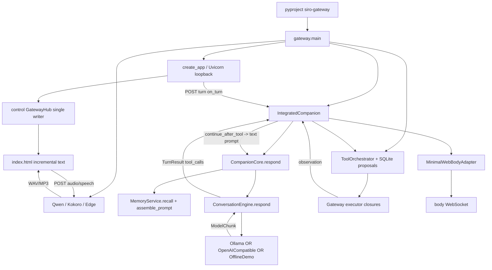

# Runtime call graph

以下是 source 組装路徑，不代表目前服務已啟動。符號行號可在 SOURCE_INVENTORY.json 查找。

## 入口、循環與 transport

| 入口 | 長駐/生命週期 | 邊界與實際用途 |
|---|---|---|
| `gateway.py:main` | Uvicorn asyncio；control/body/audio WebSocket writers | HTTP session/turn/cancel/memory/STT/TTS；Web UI 同機 loopback |
| `cli.py:main` | CLI command；demo input loop | offline demo、doctor/config、backup/restore/release；不是 Gateway 的控制 loop |
| `runtime/siro-runtime/src/main.rs` | `serve_once` loop | owner-only local socket RPC、secret、SQLite grant/action ledger；Gateway main 未建立 client |
| `services/compute/worker.py:main` | asyncio TCP server | 獨立 compute worker，預設 loopback；測試 payload/chunk/digest 不能當作遠端 LLM 接通 |
| `scripts/qwen_tts_worker.py` | stdin JSON-lines / stdout base64 audio | lazy child、獨立 venv、CUDA/CPU；未見 Gateway shutdown close |
| `operations.py` 生成 systemd user unit | Restart=on-failure | 安裝時產出；是否已安裝/啟用 UNKNOWN |
| NATS/JetStream、MQTT broker | 外部 process | library/test/demo path；Gateway main 無啟動/訂閱它們 |

## 已接通的細節

- `gateway.main` provider 優先序：SIRO_OLLAMA_MODEL → SIRO_OPENAI_API_KEY + SIRO_OPENAI_MODEL → OfflineDemoModel。沒有實例化 FailoverModel 或 Router。
- 工具 catalog 在 `integrated.py:_AGENT_TOOLS`：browser.navigate+read、computer.execute。executor map 另含 process.start；它沒有出現在模型 catalog。
- browser executor 每次 `async with ScopedBrowserDriver`，navigate 後關閉；沒有持續 browser session。
- computer executor 直接 asyncio subprocess，communicate 後才切 64 KiB；timeout kill 直接 process，沒有 process-group cancellation 路徑。
- auto_authorize callback 讀取 full mode 和 tools switch；proposal hash/狀態機有效，但不代表 Rust grant 驗證已接入。
- `IntegratedCompanion._ensure_core` 實例化 SQLite identity/memory/affect/relationship/run repositories；情緒狀態透過 broadcast 與 body 消費。
- `services/affect/planner.py` 的 AffectDecisionLoop 與 planner 在測試中使用；不是上述 main loop 的呼叫者。

## 測試與真入口差異

`test_integrated_companion.py` 用真 Core/SQLite/Hub 與假模型/執行器。`test_gateway.py` 用 create_app dependency injection，部分 legacy_shortcuts=True。通過這些測試不能證明 main 的 executor closures、真 provider、真 Qwen 或真 WebGL 畫面通過。
