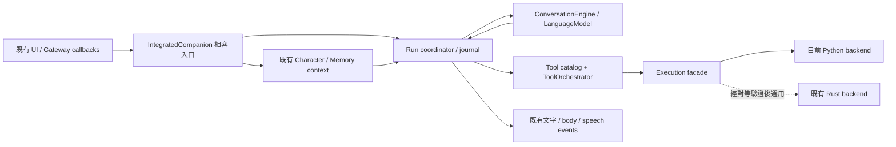

# SIRO Runtime Evolution 規格

> 2026-10-01 狀態說明：下列「尚未實作／僅設計」為 Phase 2 原始設計時點。當前逐卡完成與修正狀態以 RUNTIME_EVOLUTION_ROADMAP.md 及對應 evidence 為準。
2026-09-30；狀態：設計完成、尚未實作。依使用者授權進入 Phase 2。依據為本目錄 Phase 1 稽核及固定 Hermes snapshot；不把未驗證的能力當成完成。

## 目標與範圍

形成 SIRO 自己的 runtime：同一任務有穩定的目標、訊息、工具結果、取消及恢復狀態；文字、聲音、角色與既有 memory/relationship 行為可繼續運作。Hermes 提供 agent loop、工具登錄、session、execution lifecycle 的參考，不新增 Hermes dependency、不 fork、不搬移整個架構。

本期交付分為 G1 可靠工具迴圈、G2 有界執行與語音、G3 可恢復任務。G4 session/context/provider/browser、G5 memory/scheduling 為後續可獨立啟用增量。G1–G3 通過才能稱「SIRO Runtime 基礎整合完成」；不能因此宣稱真智慧家庭、sudo 或長期自主人格完成。

## 保留與責任

| 現有位置 | 決定 | 邊界 |
|---|---|---|
| ConversationEngine / LanguageModel / model adapters | KEEP + EXTEND | 一次模型 generation、stream、token cancellation；不接 OS |
| CompanionCore / memory / identity | KEEP | 身分、來源、情緒 context 組裝；不把 tool result 當 user utterance |
| IntegratedCompanion | 漸進 WRAP | 保留 Gateway callbacks 與 affect/body 流程；run orchestration 可逐步委派 facade |
| services/agent/runs.py | EXTEND | durable run/step；新 journal 為 additive，無全表改名 |
| ToolOrchestrator | EXTEND | proposal/argument hash/授權/執行狀態；catalog facade 共用 schema 與 executor |
| Rust RPC/LinuxDriver | KEEP | 已有 scoped operations；先接 facade，再另行驗證 Rust backend，不強迫搬 Python |
| Live2D / affect / relationship / memory schema | KEEP | 不改資產、算法、immutable identity 與既有 state 格式 |
| Qwen worker | EXTEND lifecycle | 保留 qwen3-siro-anime-daughter-v1.wav、模型與音色；修正取消/關閉/回覆關聯 |

虛線 backend 尚未實作。facade 與 journal 是責任名稱，不要求立刻新增 package 或搬檔。

## Run 與訊息契約

- run_id 對應一個使用者目標；session_id 可有多個歷史 run，同一 session 同時只有一個 foreground run。新輸入先 fence 舊 generation，再建立新 run；不共用 mutable step counter。
- 每 run 保留 initial user goal、context snapshot、assistant tool calls、tool observations、final/error。上下文來源分離：runtime instructions、使用者輸入、來源記憶、工具資料。既有 prompt fallback 保留，但新路徑必須保留原生 role/call_id。
- journal 順序：提交 assistant batch → 提案/授權 → 記錄 action dispatch intent → executor → 記錄 observation → 全 batch terminal → 下一次模型。預設循序执行，第一期不加 parallel tools。
- 同一 batch 的每個 call_id 恰有一個 observation（包括 denied、failed、cancelled、outcome_unknown）；未完成 batch 不送下一次模型。重複 call_id 拒絕或對既有結果去重，不再次執行。
- 工具結果是資料，不能自稱 system/owner instruction。模型不能自行改變 full mode、grant 或 kill switch。
- 預算獨立記錄 model_rounds、tool_calls、elapsed time、可得的 token/cost；保留現有 8-step 預設的使用者可見限制，先明確把它映射為 model rounds，再用相容測試固定。不以 journal event 數代替工具預算。

### 狀態與恢復

既有 RUNNING/WAITING_TOOL/COMPLETED/FAILED/CANCELLED 的外部表現保留。新 journal 可用內部 interrupted、outcome_unknown、needs_reconciliation 描述細節，初期不新增舊 reader 無法解析的 enum 值。

每個 run 固定 runtime_version、feature profile、backend 與 epoch。取消後先封鎖新 dispatch，再取消 provider/executor/TTS，等待有界 cleanup，最後記錄 terminal。晚到輸出只可記 audit，不可發到 UI 或改已終止 run。

重啟掃描未 terminal runs：有已持久 observation 的步驟可以還原 context；dispatch 已記錄但結果未記錄的動作只能標 outcome_unknown，先 readback。不得假設 exactly-once 外部副作用；不可因 timeout 或 crash 直接重送安裝、寫檔、發訊息。無 readback 方法時保留 unknown、明確呈現，不假裝成功。

## Execution / tools

ExecutionContext 設計欄位：run/session/call/proposal ids、epoch、deadline、cancellation、authorization decision、output budget。adapter 讓舊 executor(arguments) 繼續可用，新 executor 可取得 context。結果 envelope 保留現有 observation，另附 outcome、error_code、retryable、truncated、readback evidence；unknown outcome 預設不可重試。

full authorization 是使用者既有偏好，預設保留；新增邊界不是重新要求逐步確認。工具 kill switch 與現有 capability 限制持續生效。sudo broker 留待獨立設計與實測，不將 full mode 等同 Linux root。

process handle 管理由 backend 持有；foreground child 建立獨立 process group，cancel/timeout 先 TERM、寬限後 KILL 並 reap。detach 需明確 lifetime（run 或 session）；沿用舊 detach 行為前先記錄相容基線，禁止以 PID 名稱掃描方式殺程序。

stdout/stderr 持續有界 drain，保留總量上限與 truncation，避免 communicate 完才截斷；達上限繼續 drain/discard 或有界終止，不能因 pipe 滿而死鎖。

工具 catalog 同一筆 descriptor 提供 schema、executor、availability、effect class、backend；每回合快照 catalog，dispatch 時再檢查工具 switch/可用性。先包現有兩工具，skills 不自動全部曝光。

## Qwen lifecycle

request_id + generation/epoch 跟隨每個 render；worker reply 必須配對。timeout/cancel/protocol mismatch 後隔離舊 worker並 terminate/wait，再允許新請求；startup failure 也要清理。Gateway lifespan close worker。單 GPU worker owner，等待佇列有界，拒絕超量時回傳可辨識錯誤；保留文字輸出。

不在此工作更換音色、重新訓練或改成串流 TTS。首包延遲是後續量測項，不拿 lifecycle 修正宣稱聲音更自然。

## Session / context / providers / memory

- 恢復 canonical messages，不把舊 assembled prompt 誤認為原始 user text；舊紀錄不強行解析，標 legacy/unrestorable，維持既有可用記憶查詢。
- context budget 先量測並限制，保留目標、未完成 batch、授權 facts 與來源；只摘要已完成區段。summary 帶 provenance/version，可失效重建，不寫回 personality facts。超限且不可安全壓縮時回報，不刪 pending tool pair。
- provider policy 先包既有 FailoverModel。只有尚未輸出文字或工具意圖的 generation 可自動換 backend；輸出後失敗停止並保留狀態。local_only 不擴大外送，費用上限未設定不可默默新增 cloud fallback。
- memory ingress 與 conversation persistence 分開。使用者明確要求記住及可驗證事件形成有來源候選；先接既有 commit/correct/delete/revision，不將任意聊天、情緒猜測或摘要當成事實。
- scheduler 接入只處理有界、已授權的本地候選。預設維持 proactivity 關閉，前景對話和取消優先；先不接真設備或自動安裝 skills。

## 非目標

本期不重寫 Core、不改名稱/目錄結構、不移植 Hermes、不改 Live2D 資產、不以情緒算法宣稱主觀感受、不完成 ESP32/HA/雙節點驗收，也不把 release manager 或 self-modification 自動啟用。

## 驗收量測（提議門檻，非已量測）

1. 100 次合成多工具/錯誤/取消交錯：零重複 dispatch、零漏配 tool result、零 terminal 後 UI 輸出。
2. 本機受控 child cancellation 2 秒內停止並 reap；超時仍須在 5 秒內回報 cleanup failure，不隱藏殘留。
3. 100 MiB 合成 output：保存不超過配置 cap，executor 額外 RSS 增量目標小於 32 MiB；量測環境與 child RSS 分開。
4. 在 dispatch 前後/observation 前後 crash 注入：恢復零盲目重送，所有 unknown 可見。
5. Qwen fake worker 故障矩陣無錯配/殘留；真 RTX3050 一次冷啟動、重複 render、cancel/restart，沒有第二個佔 GPU worker。
6. unchanged legacy profile 的文字、角色、音色、memory/relationship fixtures 不退步；延遲與資源比較記錄實測，未量測不設虛假改善率。
