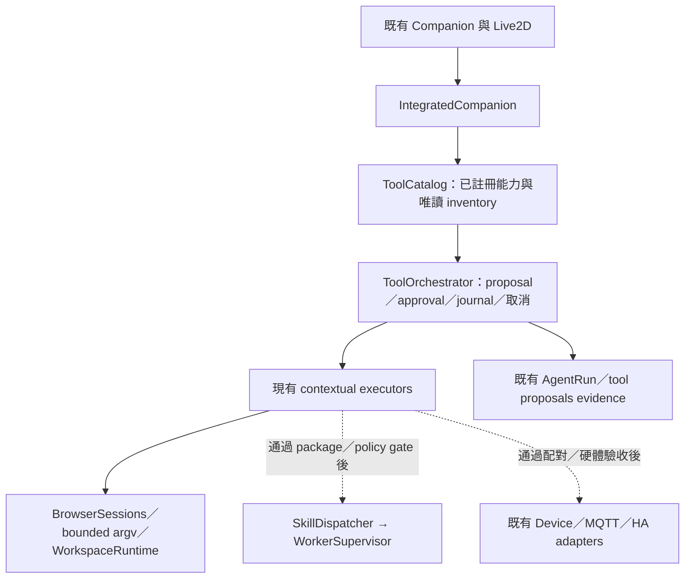

# Runtime Intelligence 整合設計

## 2026-10-14 — D55 proposal caller limited VERIFIED

RI-006 D55只到單一HTTPStatusError來源的唯讀調查view/caller，重用D41，無rootcause推論/假patch/自批/重試/部署。Corepure→已startup的Integratedrepo→authenticatedno-storeGET→手動UI，source失效與ownedcancel已驗。FIX018/019本candidate局部修復，1798PASS/5opt-inSKIP、全scripts/check EXIT0；actualmain/browser/來源更正/收尾/exact6rollback保持。RI006仍PARTIAL，RI005releasegates與原產品品質gate保持。請以STATUS最新front與[D55報告](../evidence/RI-006-2026-10-13/REPORT.md)為準，歷史sections不代表現狀。

## 2026-10-12 — RI-005 D50 owner / FIX-014 限定切片 VERIFIED

受管Gateway與CLI demo/backup/restore/有DBrelease在實際操作前取得同一canonical data owner，持有到startup/server drain/owned SQLite IO完成；備份來源、explicit目的地、ZIP固定.tmp共同有序去重（最多3keys）、一份IOjoin fence。真正foreignowner/alias與連續SIGINT反例先RED→局部修復；禁止output/tmp覆寫sourceDB/inputsettings/archive或tmp指向final，不改Core/SQLite/operations/release/權限/voice/UI/launcher/deps。沒有第二套registry/restore/lockmanager或globalstate。FIX-014 **DONE/VERIFIED**。

70新cases；最終相鄰**215PASS/10.58s**，完整**1,553PASS/5 real_provider未選/3既有warnings/157.81s**；Ruff309/mypy243/schema/diff PASS。真offline Gateway HTTP、kernel contention/fork/exec/aliases、raw/demo/ZIP三次SIGINT、3FD join/partialcleanup；fault/timing控制明示。baseline268中266不改、exact5source-only temporary reverse/reapply PASS、D47/D48/D49保留。獨立contract16PASS並重綁final5，lifecycle reviewer最後turn碰accountlimit，不假稱三份final批准；final OS probe另列。敏感掃描與cutoff見報告。

另真ZIP backup-stage probe確認未改的backup_to取消早退→TemporaryDirectory先清理→late IO重建staging，command join後仍留snapshot/sidecars：**FIX-015 REQUIRED_FIX/MEDIUM PLANNED / FAILED_VERIFICATION**，不是D50 lease失效。原dir0700、重建0775，實測DB/sidecars0600，沒有其他UID可讀內容證據。只要求既有backup局部canceljoin/明確close，不在本卡擴全SQLite。RI-005整體**PARTIAL / BLOCKED_BY_FIX: FIX-015 / BLOCKED_BY_RELEASE_INTEGRATION**；ZIP完整cleanup、firstadoption舊owner停止、signedlauncher真正版本/readiness/批准handoff仍未驗，禁止用source切片PASS放行發布。

Architecture **YELLOW**；owner/Gateway **YELLOW**、合成tests/evidence **GREEN**；runningDB/migration/權限/發布 **RED**。KEEP RI-005並SPLIT remaininglauncher/handoff，KEEP RI-006只到唯讀提案；REJECT重複owner/restore abstraction，未證任何 numberedtask冗餘，不硬CANCEL。RT-011/013/015原scopedDONE/編號不變，FIX-002/005/006產品gate保持。接續三窄卡（非ranking）：FIX-015局部backup cleanup、RI-005人工批准version/readiness/handoff、RI-006來源失敗→唯讀提案。沒有live8026重啟、私人DB/chat/WAV/key/config/model/GPU或發布。

[實際驗收、限制與精確回退](../evidence/RI-005-owner-2026-10-12/REPORT.md)。

## 2026-10-12 — D49 / FIX-013 explicit restore 局部修復 VERIFIED

真正 temporary SQLite 證明舊路徑先覆蓋 live 再拒 migration/checksum，且 cancellation 提前釋放 writer lock。只改既有 SQLiteStore：mode=ro/query_only source→owned candidate→known prefix/checksum/既有遷移/integrity→SQLite backup promotion；不replace live/WAL。原 per-store writer lock 持有到 offloop thread/explicit connection close/cleanup joined；取消中止未完成 copy，DONE後取消誠實保留已commit資料。原typed error保留、cleanup refusal可見，不假稱已移除。獨立review先RED修掉Python3.14 shield重複error，只改owned await asyncio.wait/job.result，沒有新restore/schema/updater抽象。

41新cases；exact original source **30FAIL/11PASS**（5.61s）；最終專項 **145PASS**（4.95s），完整 **1,483PASS/5 real_provider未選/3既有warnings**（156.51s）；Ruff306/mypy240/schema/diff PASS。真raw/ZIP CLI、舊schema/WAL/來源唯讀、取消/queued writer/ledger retention驗收；IO/清理/進度timing標controlled。三份獨立review重綁final source後無scoped blocker。266 baseline中265不改、新2tests，exact3 source-only reverse/reapply PASS，D47/D48保留；final source3/docs12掃描0；evidence55inputs/277逐項capturedSHA256誤報/unresolved0，cutoff 2026-10-11 17:58:09 UTC（audit outputs與此後結果annotation排除）。

FIX-013 **DONE/VERIFIED**，只解除此explicit-restore failure gate；RI-005整體 **PARTIAL / BLOCKED_BY_RELEASE_INTEGRATION**：activepointer不等於真正版本，stopped writer／實際launcher/version/readiness／人工批准還未驗。成功明確data restore可替換近期資料，code rollback仍只切版本；commit後取消/cleanup failure需readback再決定，不重送。沒有live8026 restart、privateDB/chat/WAV/key/model/GPU或發布；FIX-002/005/006產品gate與RT-011/013/015 scopedDONE不變。

Architecture YELLOW；restore元件YELLOW、合成測試/evidence GREEN；運行DB/migrations／權限／發布RED。ZIP DB/config跨檔atomic、multiprocess lease、powerloss不算本卡驗收；candidate disk-capacity／舊backup retention為TECH_DEBT/DEFER，不建新manager。KEEP RI-005、SPLIT stopped-owner與actuallauncher；接續三窄切片RI-005 owner、RI-005 approved launcher/version/readiness、RI-006唯讀提案（非ranking、不重編）。Hermes REJECT重複restore/evolution abstraction，DEFER任意自改/發布直到接入有證據；本卡無new scoped blocker。

[驗收、限制、精確回退](../evidence/FIX-013-2026-10-12/REPORT.md)。

## 2026-10-11 — RI-005 D48 / FIX-012 code-only回退限定切片 VERIFIED

原T32把版本回退與wholeDB restore綁一起，舊測試要求新寫入消失，是ORIGINAL_DESIGN_ERROR／REQUIRED_FIX HIGH，不是新Sol regression。[最小架構更正](ARCHITECTURE_CORRECTION.md)。只改既有ReleaseManager：新staged版本保存完整D39signedmanifest sidecar並拒順序同版覆寫，health後再驗來源；rollback驗精確target/signature/alias＋實際readonly schema prefix，unknown/incompatible拒絕，只切active pointer、從不讀舊backup還原或migrate/replay。既有獨立siro restore保持分開，移除只被舊rollback使用的private restore helper。API/CLI/簽章格式保持，危險資料回退語意明確撤銷；沒有自動信任升級/新updater/schemaengine/lockservice。

新51cases＋原release/signing/launcher/operations94PASS（3.75s）；完整1,442PASS、5 real_provider未選、3既有warnings（157.59s）。真temporary SQLite/WAL晚寫/原writer仍可用、conversation/memory/完成ledger保留、real migratedDB CLI、schema/receipt/source/path負向；pointer/receipt錯誤為controlled injection，沒有實際啟動另一version或真人產品驗收。全repo Ruff304／mypy238／schema/diff PASS；baseline265中263未改、exact3 source-only reverse/reapply PASS，D47十一檔保持；3source/13publicdocs敏感掃描0；evidence 273逐項SHA256誤報、unresolved0；cutoff 2026-10-11 15:53:57 UTC（audit outputs與後續status/count annotation另排除）。

另外真合成probe確認SQLiteStore explicit restore在migration/checksum failure前已覆蓋live：**FIX-013 REQUIRED_FIX/HIGH PLANNED，該failure path FAILED_VERIFICATION**，此卡未改SQLite/migrations。RI-005整體PARTIAL，full activation／data-restore acceptance標BLOCKED_BY_FIX: FIX-013與原BLOCKED_BY_RELEASE_INTEGRATION；active pointer≠真正執行版本，launcher仍需consume/readiness與stopped-writer gate。元件source rollback不授權重新呼叫舊危險DB回退。沒有live8026/privateDB/chat/WAV/key/model/GPU/發布。三個分派審查turn碰帳戶limit，最終獨立review NOT_RUN，root直接source/實測不冒充獨立批准。

Architecture overall YELLOW；ReleaseManager元件YELLOW、合成測試/docs GREEN；運行中的DB/migration/權限/發布仍RED。順序immutableversion/read-schema snapshot不等於concurrent owner lease、powerloss或實際loader相容。保留舊backup但不自動用其回退是TECH_DEBT retention，不擴全局抽象。KEEP剩餘RI-005並SPLIT stopped-writer/actuallauncher；下一三張接續範圍FIX-013局部prevalidation、RI-005剩餘接線、RI-006唯讀提案（非ranking）；RT-011/013/015 DONE保持，FIX-002/005/006產品限制不解除。

[完整驗收與回退](../evidence/RI-005-2026-10-11/REPORT.md)。

## 2026-10-11 — RI-004 D47 固定技能產品接入（限定切片 VERIFIED）

既有D44準備/真驗證＋D46strict worker接進同一registry/catalog/orchestrator/dispatcher：server-held review900s/完整identity→人工安裝disabled→另一步明確enable→原對話tool批准→revoke；沒有模型自批、任意code/依賴、第二套registry/scheduler/schema。新facade/CAS不覆寫同版，queued/active jobs先fence再join，取消offloop交易補disabled，cleanupfailure仍嘗試durable revoke、保留typed error。Startup只恢復精確固定模板/receipt/row，tools-off持久停用，shutdown保留原owner明確批准供exact restart。

最後真畫面發現準備紀錄與已安裝狀態矛盾，補2個RED→局部history-label修復，不改匯出原始事實。最終189專項PASS（17.12s）／完整1,391PASS、5 real_provider未選、3既有warnings（154.61s）；Ruff302／mypy237／lint／schema PASS。真CUA/HTTP/SQLite/bwrap走通安裝disabled→明確enable→填入不送出→revoke/readback，fixture退出0、owned jobs0、暫存清除。最後exact11 source回退/reapply與獨立綁定PASS，baseline258中254不變，D46七檔/Core/policy保留。11source/10publicdocs敏感掃描0，evidence356逐項digest誤報/unresolved0（02:10:44UTC cutoff；後續僅狀態/計數annotation）。最後console一則無來源MutationObserver錯誤，origin UNKNOWN，已留證據，未宣稱零錯或猜測修復。實際產品驗證只temporary18034，不讀私人DB/chat/WAV/key、不碰模型/GPU、不重啟live8026或正式部署。

RI-004整體仍PARTIAL，但固定builtin checklist人工批准/strict執行/撤銷切片的局部caller接入gate已解除。RI-005 launcher/single-writer/latest-data-preserving rollback保持BLOCKED直到各自驗收；RI-006 KEEP，FIX-002有用搜尋/FIX-005速度人耳/FIX-006真理解保持既有產品限制。RT-011/013/015 DONE不重開、不重編、不ranking。Gateway/registry/catalog保持YELLOW（新owner生命週期），D46已驗限定profile可GREEN，Core/permission/release仍RED freeze；sameUID/任意生成/multiprocess/aggregateRAM不算通過。沒有original design correction或新全局state manager。

[完整變更與驗收](../evidence/RI-004-activation-2026-10-11/REPORT.md)。

## RI-004 strict worker addendum — 2026-10-11

D46 actual fixedstdlibworker slice VERIFIED，與RI-003共用lower isolation/restrictions，D45 soleprocessowner與defaultcompatible保持；真D44package→正確parseroutput、51新cases／完整1,202PASS／exact7回退。[證據](../evidence/RI-004-worker-2026-10-11/REPORT.md)。後續設計只需產品server-heldreview/ownerapproval/install-enable-revoke/catalog，不能再造另一sandbox/registry或重做已存在capture。Limitedprofile不認證generaldeps/multiprocess/其他OS/aggregateRAM，workerPASS不批准候選。

## RI-004 implementation addendum — 2026-10-10

D44 explicit-owner fixed Markdown checklist template→全typedcatalogcheck→completecapture→realRI-003verification→review/export切片已VERIFIED。這是builtin template、不是任意model生成；不查installedregistry／不install/enable。88新cases、完整1,127PASS、真Chrome23checks、exact6source回退支持局部接入；整體PARTIAL，workerboundary/securityreview/明確批准/撤銷仍需獨立驗。設計後半段是接入gate，不能照原圖硬加planner／registry或把metadata當授權。[證據](../evidence/RI-004-2026-10-10/REPORT.md)。

## RI-002 implementation addendum — 2026-10-10

本文件中的第一個catalog唯讀切片已實作與驗收：typed metadata、同次capture、authenticated既有API/UI，以及每model round更新的owned context；不新增discovery執行能力、不將metadata當授權。詳細source/tests/相容／回退見 [RI-002 REPORT](../evidence/RI-002-2026-10-09/REPORT.md)。其餘P2/P3接入仍是設計與gate；本次不標自主技能或部署DONE。


日期：2026-10-09。狀態：**設計／接入 gate；未交付自主 skill generation 或自我部署**。依 [CURRENT_ARCHITECTURE_AUDIT.md](CURRENT_ARCHITECTURE_AUDIT.md)、[CAPABILITY_MATRIX.md](CAPABILITY_MATRIX.md) 的現況延伸既有系統。本文件是 [COMPANION_EVOLUTION_PLAN.md](COMPANION_EVOLUTION_PLAN.md)「擴充功能的穩定邊界／安全進化流程」的程式契約補充；桌寵場景、角色動作、語音產品計劃沿用原文件，不再建立另一套產品方向。

## 目標與保留項

讓 SIRO 正確說明自己目前能做什麼、選擇已驗證工具、在缺能力時準備可審核的候選。先改善日常互動與可靠性；程式碼理解是開發輔助，不把陪伴產品變成只會修改程式的 Agent。

保留 Python Core／ports、IntegratedCompanion、ToolCatalog／ToolOrchestrator、SQLiteSkillRegistry／SkillDispatcher／WorkerSupervisor、MemoryService、AgentRun journal、MemoryOrganizer、既有 browser/workspace/device adapters 與 Web Live2D。新能力沿 extension points 接入；不新增記憶 DB、向量 DB、通用 scheduler、registry、工具 executor、model router 或 background worker。

以下是**責任關係**，不是七個待建服務：



## 三種資料分離

| 責任 | 現有／預定 owner | 可以包含 | 不可以據此宣稱 |
|---|---|---|---|
| Codebase Knowledge | 開發期 Codebase Memory MCP，本機受控 source index | source symbols、依賴、call chain、commit/hash、工具版本與索引時間 | 使用者偏好或角色記憶；MCP 圖譜自動賦予 runtime 權限 |
| Agent Memory | MemoryService／SQLite repositories／來源與 revision | 明確使用者記憶、事件、偏好；既有 privacy/scope/correction/deletion | graph query 結果成為新 facts；摘要降低資料 privacy |
| Runtime State | IntegratedCompanion／AgentRun journal／ToolOrchestrator／既有 owner | 活動 run/call/proposal、cancel、未知結果、availability、資源狀態 | 任務重啟就重播效果；process alive 就證明 capability 正確 |

開發工具只索引明確指定的 source/test/config-public 範圍；不讀 `.siro-data`、私人聊天、原始音訊、models、credentials、`.env*` 真值。索引版本與 source hash 可用於**核對**，不能取代直接 source/test verification。MCP 安裝／工具名稱／實測查詢／watcher 狀態由 Codebase Memory Integration Report 記錄，不在此虛構參數。正式 SIRO runtime 目前沒有通用 MCP client；本次不偷偷把開發 client 變成 runtime service。

## 現況 gap 與採用決定

| 決定 | 既有實作／缺口 | 預期收益 | 風險／複雜度 | 依賴 |
|---|---|---|---|---|
| REUSE | `ToolCatalog.require/definitions/snapshot`（`orchestrator.py:170/182/189`）＋same descriptor executor | 能力與 schema 不再重複維護，availability 變化即時可見 | 低；availability predicate 不是完整 health probe | 保持 RT-007 baseline |
| EXTEND | ToolDescriptor 缺輸出契約、permissions、risk、version/provenance、timeout/failure；risk 顯示散在 `integrated.py:789` | 降低模型誤判與 UI 宣告過度，讓拒絕可說明 | 中；metadata 必須來源真實，不能依模型填寫成授權 | 先純唯讀 inventory／契約；再決定公開 API |
| REUSE | proposal args hash、run/call owner、journal、execution cancellation | 延續已修工具安全、不另造 dispatcher | 低；未知效果保持 unknown，不自動重送 | RT-003/005/008 與 FIX baseline |
| FIX BEFORE CONNECT | SkillManifest／registry／bwrap 已存在，但 manifest_hash 不含 plugin code/deps，Dispatcher 不驗 package identity | 防已批准版本被換碼，可信 enabled 狀態不漂移 | 高影響、中複雜度；舊 v1 相容需要明確降級範圍 | 不可在此 gate 前接 generated skill |
| MISSING INTEGRATION | SkillDispatcher／ProactivityRules／ProceduralCandidateGenerator 沒有 Gateway 產品 caller | 用現有模組接一個能驗收的日常用途 | 中；主動訊息會干擾前景，skill 有 host 安全成本 | 分開小卡，不由 discovery 自動啟用 |
| FIX BEFORE CONNECT | PatchVerifier 漏 protected deletion、same-user copy 無隔離；ReleaseManager 未簽 schema bounds | 修復審核真實性，避免候選碼碰 production 或部署不相容版本 | 高；sandbox／release 不可用一個「全部安全」布林值 | [合成反例](../evidence/RI-architecture-2026-10-09/REPORT.md)；獨立窄修復與人工 gate |
| REUSE | MemoryOrganizer source-checked disposable digest／extractive summary | 閒置整理、長對話延續已能沿用 | 低；不是語意長期 memory consolidation | RT-011/015 原有 retention／single-owner 條件保留 |
| NOT NOW | 自動 deploy、任意 CLI 掃描／網路 skill 安裝、未驗證硬體、binary reverse engineering | 目前不會直接改善主要日常體驗 | 高；安全、成本、授權與驗收不足 | 先完成語音／搜尋／理解 FIX，再逐卡提案 |

## Capability Discovery：先唯讀，不執行能力

第一個切片只從**既有 ToolCatalog** 取有界 snapshot 和 definitions；不從 LLM 自行編造清單、不呼叫 executor 測可用性、不為探索先跑任意 CLI／MCP tool。availability 來源是 composition 的 trusted predicate；慢／blocking probes 在明確刷新步驟完成，不能塞進 model request 或 Core event loop。

能力欄位來源及缺失處理：

| 欄位 | 最小來源與契約 |
|---|---|
| Identity／Description／Interface Schema | 原 ToolDefinition.name/description/input_schema；穩定 namespaced 名稱，不改舊工具 ID |
| Input/Output Contract | input schema 沿既有 validator；output schema 或具體 readback 合約由 adapter 宣告，缺失記 `unknown`，不自動聲稱可生成 skill |
| Required Permissions／Scope | 由可信 adapter／owner policy 宣告，讀取 manifest 欄位僅作需求描述；實際授權仍在 approval/runtime 執行 |
| Side Effects／Risk Level | catalog effect 與既有 RiskLevel 類型建立明確 mapping；同一來源供 UI/model，沒有 mapping 就標 unknown 並不自動授權 |
| Availability | available/unavailable/unknown，加 last checked/reason；單一 boolean readiness 為現況，豐富狀態為待驗證擴充 |
| Version／Provenance | builtin contract/source revision；固定已安裝 skill version/package digest；授權 MCP/server 或 CLI 固定來源與版本。不能把 tool name 當信任證明 |
| Timeout／Failure Behavior | adapter 實際 deadline、cancellation、idempotency／unknown outcome 契約；無實作就明示 unknown，不靠 description 保證 |

目前 `ToolDescriptor`（`orchestrator.py:146`）不包含全部欄位，因此本節是待接入契約。先由同一 catalog 產生 development inventory；只有真 product caller 需要才加 optional metadata/default 與 versioned readback，保留現有 `ToolDefinition`、`/v1/runtime/config` 與 legacy profile。不要為完整欄位清單新造 CapabilityRegistry。

其他來源接入順序：

1. 固定已安裝 Skills：先修完整 package digest／registry binding；讀 manifest/schema，不 import entrypoint、不 install、不 enable。
2. 已授權 MCP：先限制本機 server/source/tool allowlist；只 `tools/list` 讀 metadata，list 不能轉成可執行 descriptor。Runtime MCP 接入另卡驗 env、network、session、timeouts、cancellation 和輸出合約。
3. 本機 CLI：先 trusted allowlist＋可執行檔存在性／版本紀錄；不能假定 `--help`／`--version` 一定無副作用，不因探索執行從網路抄來的指令。
4. 已授權 API／服務：讀固定已知 adapter 與明確 schema；不掃 LAN／帳號，不索取或把 credential 傳進模型。
5. 已配對硬體：讀 DeviceRegistry descriptors／availability／TTL、HA adapter descriptors；沒有配對／已驗 action contract 只標 unavailable/unknown，不探測 actuator。

## Tool Selection 與執行權限

每次模型 request 沿 `IntegratedCompanion._model_tools` → `ToolOrchestrator.model_tools` → available definitions。模型只**提議** name/args；`catalog.require` 在 propose 與 execute 重驗 schema/readiness。既有 schema subset 不是完整 JSON Schema 引擎；未支援規則不可宣稱已驗。

實際產品批准是 `ToolOrchestrator.resolve` 的 argument-bound 狀態轉移，加 `ExecutionContext.authorized` 與 adapter scope；Rust workspace 另驗短效一次性 grant，browser 限 origin／screen_version。一般 argv 是使用者權限程序，**不是 scoped sandbox**；擋 `sudo`／shell string 與刪兩個 env key 不能證明整機 secrets 都隔離。不能用 `computer.execute` 替 skill/patch sandbox 補洞，或繞 workspace refusal。

新的 high-risk、自我部署、policy／權限變更不得被現有「full mode」當成全面批准。這些 control operations 不能成為模型可自行批准的 ordinary tools；批准綁 owner、candidate digest、權限 scope、有效期、source/test report。撤銷停新工作，in-flight 沿既有取消鏈處理；已發生或未知副作用誠實回讀。

## Skill Discovery 與生成

SkillManifest 已有 id/version/description/entrypoint/schema/permissions/risk/timeout/concurrency/resource/network/idempotency/cancellation/compensation（`core/skills.py:35`）。缺 source/trust/test-status 和 code/dependency content identity；不要建平行 manifest／registry，先定義 backward-compatible package metadata。v1 只能維持既有 trusted-local 用途，不能因 metadata 缺失自動取得 generated-code 信任。

流程必須是：

```text
User Request → Missing Capability Detection → Existing Tool Search
→ Capability Specification → Candidate Skill Code Generation
→ Static Validation → Sandbox Testing → Security Review
→ Human Approval → Registry Install(disabled) → Explicit Enable
```

- 前兩步沒有查證實際缺口就不能生成程式；若已存在可用工具，直接沿既有工具流程完成。
- Candidate spec 固定輸入／輸出、來源、side effects、權限、timeout、failure/idempotency、tests、資源預算和 rollback；禁止包含 secrets。
- Static validation 不 import 候選，核對 schema subset、相對路徑、包完整 hash、依賴來源／lock／license、拒絕未支援權限與網路需求。package approval 綁所有可執行碼與依賴，不只 manifest。
- WorkerSupervisor 的既有 bubblewrap network denial、ro mounts、clean environment、CPU/AS/output/timeout/concurrency 是基礎（`adapters/skill_worker.py:36`）；已有 fixture 測試。使用 arbitrary generated code 前，另驗 process descendants、PID／mount/device/credential 範圍、kill/timeout cleanup、長期 semaphore retention；不能把本次 40 PASS 視為全面敵意程式證明。
- Filesystem/network/process/credentials/hardware 權限各自預設拒絕。技能直接 host DB 寫入／raw hardware 指令不合法；對外能力只能走已批准 existing service adapter。
- 安裝、security review、approval、enable 是可信 owner control path；`SQLiteSkillRegistry.install` 預設 disabled 保留。模型不能發 tool call 自行更改 registry enable，更新需新 digest／重新驗證批准。
- 先只接一個固定 read-only synthetic skill，以 namespaced ToolDescriptor → 既有 ToolOrchestrator → SkillDispatcher → WorkerSupervisor；任何環節缺失就 unavailable，不 fallback 直接 import。

ProceduralCandidateGenerator（`core/procedural.py:55`）只接受重複 trusted successful trace、產出 candidate，不會生成 enabled skill。它可沿用作「重複工作」提案來源；其現有 redaction/fixture 覆蓋有限，不能任意收集私人 tool outputs，trace freshness／敏感欄位／來源撤銷需先驗。

## Self-Improvement：初期只到提案／供審核修改

固定階段：**Analysis → Proposal → Isolated Implementation → Testing → Review → Approval → Deployment → Monitoring → Rollback**。

| 階段 | 重用與最小產出 | 阻擋條件 |
|---|---|---|
| Analysis | 現有 AgentRun steps/tool proposals/provider exceptions/Qwen safe diagnostics；開發期 source graph 做 impact analysis；只匯總 trace IDs、錯誤類型、分段耗時／size/count | 不能把私人 raw prompt/audio/tool payload 默認送開發模型；沒有量測就 unknown，不能猜「笨」的 root cause |
| Proposal | 現有 PatchProposal 作差異載體，附 problem/evidence/confirmed root cause或UNKNOWN、benefit/risk、files/tests/rollback；連結既有 FIX | 提案不能直接修改 running tree；根因未知先調查，不擴 subsystem |
| Isolated Implementation | 每個 patch 使用獨立 branch/worktree＋合成資料；PatchVerifier 的 copy 可做 workspace | copy 不是 security sandbox；untrusted candidate check 執行需要真正 OS／restricted process 邊界，production/env/privateDB 不可見 |
| Testing | 原 unit/contract/integration/regression、安全負面 tests；涉及效能才加 fixed hardware/sample workload；保存 source hash／commands/results | protected delete/rename、sandbox escape、signature tamper／DB rollback gate 沒解不得推進；未跑不寫PASS |
| Review | 開發者審核最小 scope、capability/privacy變化、依賴、完整 diff | Agent 不能刪保護測試或自行修改通過門檻；靜態 dead-code 推斷不能刪動態註冊 caller |
| Approval | 初期輸出 reviewable proposal 或 PR；人工批准綁 candidate/test/policy版本 | 模型、skill、全權 mode 均不能批准自身 policy/deploy |
| Deployment | 暫維持既有人工啟動／維護流程；ReleaseManager 是 standalone CLI 元件 | D52 signed launcher已consume精確complete manifest選版並驗actualsource/same-schema ready；D39/D48 code-only retention、D49 restore、D50 managed owner與D51/FIX-015 cleanup局部VERIFIED。Firstadoption舊writer、verify/import immutablebytes與人工maintenance/runtimehandoff仍block；不自動deploy |
| Monitoring | 同一 source版本的 health、error rate、cancel/no-replay、latency/resource；觀察窗口依該卡實測定義 | health 回200不能代表完整產品；先列 rollback trigger再部署 |
| Rollback | 回退本次 source／config／技能固定版本；保留事件與新資料，關閉新能力 | source rollback 與 DB restore 分開；資料回退需停止 writer、獨立備份／完整性／schema相容與 owner批准 |

本輪合成反例已證實 PatchVerifier 的 protected-delete 漏洞與 sandbox 誤用，ReleaseManager schema tamper。[重現與限制](../evidence/RI-architecture-2026-10-09/REPORT.md)。先用窄修復恢復 invariants，不要求新 evolution service。Deployment gate 的順序不能被「已有 T31/T32」略過。

最低 observability 改善先補既有結果的安全 reason code（例如 scope_denied，不含私人 URL/query／credentials）、proposal/run/call correlation、timeout/cancel/unknown分類與工具 metadata 的 availability reason。耗時欄位用 monotonic 明確開始／結束，觀測不能執行新工具。已有語音 evidence 直接重用，不另造 metrics DB 或常駐 worker。

## ESP32／Home Assistant／未來設備

沿 `DeviceDescriptor`、DeviceRegistry availability/TTL/action-schema（`core/devices.py:30/74`）與 `HomeAssistantAdapter.descriptors/state/set_light/state_changes`（`adapters/home_assistant.py:217/228/275/323`）。MQTT `DeviceCommand` 的 command_id/expiry、non-retained、duplicate拒絕，CommandTracker 的 ACK≠CONFIRMED（`services/devices/mqtt.py:19/47/84/119`）保留。

發現設備只讀已配對 descriptors 與來源／時間／TTL，不能下 raw pin／串口／韌體命令測試。「開燈」先在既有 room/device adapter 建可驗證 action，先查當前狀態，再授權、送命令、ACK、狀態 readback；timeout 未知就查結果，不重送 toggle。真 ESP32／HA 與客廳實際環境驗收目前未跑，只有 mock／simulation測試不能標 hardware ready。

## 遠期軟體理解與資源

P3 才評估授權軟體分析，順序是官方 API → CLI → docs → 已知 MCP → 可用 source → GUI → 已授權靜態分析／反編譯。Ghidra／LSP／Tree-sitter 的存在不是安裝理由；Codebase Memory 可先滿足的 source 理解不再加平行 graph。反編譯輸出不承諾完整還原，也不改變軟體原有授權。

開發 graph 不進 Core 熱路徑、不佔 GPU、不在正常陪伴時 reindex；先量一次 indexing 的 time/RSS/disk，再決定 watcher／頻率。memory digest 沿現有 single owner，重型分析／skill test 需 governor／前景優先／有界 deadline／取消，不創建另一個 background scheduler。

## 驗收、相容與回退

- 本輪只能把實際配置、文件、現有接口測試補強算實作。能力 generation／runtime MCP／自我部署仍是未實作設計；每個後續小卡需獨立 acceptance/test/rollback，不修改既有 T/RT 歷史。
- P1 discovery 的驗收：catalog source一致、unknown capability與未知schema拒絕、disabled/unavailable不對模型宣告、snapshot不呼叫任何 executor、不讀 secret、既有工具IDs／API／candidate與legacy結果相容。
- P2 的驗收：package換碼／換依賴無法沿舊approval執行、預設disabled、revocation即時、schema/output/timeout/CPU/memory/output flood、network/host/secret/descendant cleanup負面fixtures，單skill失敗不阻擋文字／body／cancel。
- P3 proposal驗收：protected file新增／刪除／rename皆拒絕、候選執行碰不到production、完整簽署相容欄位、假health／migrationfail／activationinterruption／lateDBwrite／rollback無replay、人工approve不可偽造。不滿足就停留提案。
- 保持 `SIRO_RUNTIME_PROFILE` startup-frozen 邊界，existing feature kill switches 與舊 API。新增 metadata 先 optional/additive；改 schema/grant/wire 先 ADR與契約，不為整合新能力強行 migration。
- 回退本次 docs／dev配置可逐檔還原；停 MCP／刪指定 code index 只影響 devknowledge。未接入 runtime所以不重啟產品、不移除現有記憶。後續 skill rollback 停新dispatch／cancelowned工作／disable新版本／恢復明確舊digest，不覆蓋新memory或ledger。

Freeze：dev inventory／devdocs GREEN；產品 ToolCatalog metadata、conversation/tools/body YELLOW；identity/schema/grants、generatedcode啟用、untrustedpatchchecks、autodeploy/DBrestore RED。先修已重現 root cause，不為達成架構圖擴 abstraction。
